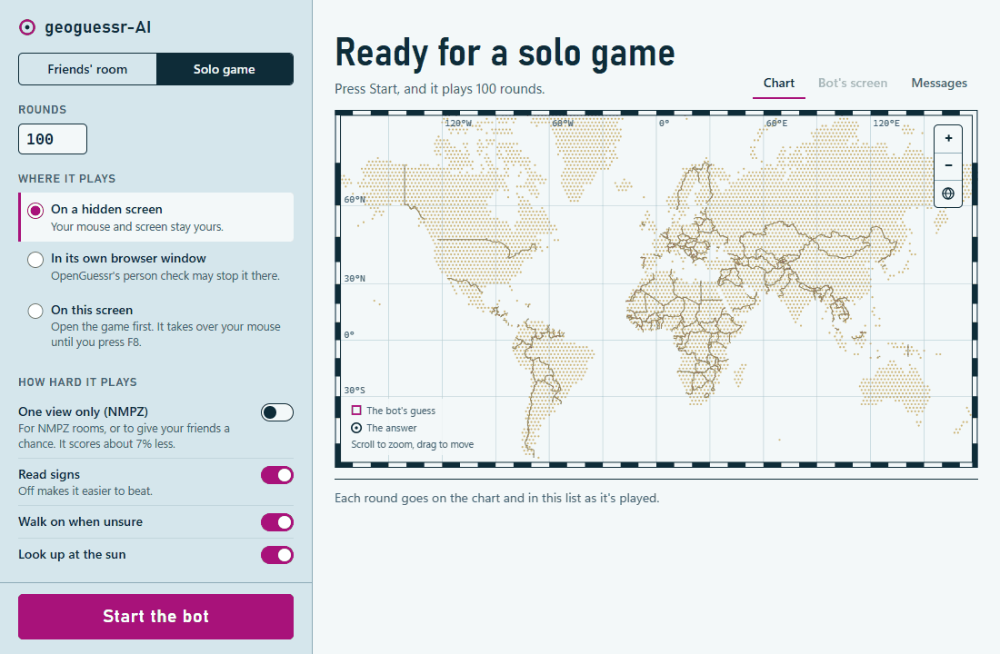

# geoguessr-AI

[](https://github.com/andrey-rublev/geoguessr-AI/actions/workflows/tests.yml)
[](https://github.com/andrey-rublev/geoguessr-AI/releases/latest)
[](LICENSE)

An AI that plays [OpenGuessr](https://openguessr.com) by looking at the screen and moving a mouse. It never reads the page's code, and it learns from the rounds it plays. On 1,338 held-out rounds it averages about 3,770 of OpenGuessr's 5,000 points a round.

For fun and learning. Only play it against friends who know it's a bot, never in ranked or public games.

<picture>
  <source media="(prefers-reduced-motion: reduce)" srcset="docs/app.png">
  
</picture>

**[Watch that game in your browser](https://andrey-rublev.github.io/geoguessr-AI/)**, played back in the app, with nothing to install.

## Get it

On Windows 10 or 11, download **[geoguessr-AI-Setup.exe](https://github.com/andrey-rublev/geoguessr-AI/releases/latest/download/geoguessr-AI-Setup.exe)** and run it. It needs no administrator or Python. Windows may warn that it doesn't recognise the installer, as it isn't signed: choose **More info**, then **Run anyway**. Or, in PowerShell:

```powershell
curl.exe -Lo geoguessr-AI-Setup.exe https://github.com/andrey-rublev/geoguessr-AI/releases/latest/download/geoguessr-AI-Setup.exe; .\geoguessr-AI-Setup.exe
```

Setup fetches the libraries (about 1 GB), and the app then offers to download the model (about 2.2 GB): about 4 GB of disk in all. It plays best with 8 GB of memory or more. On an Intel GPU it thinks in under a second a look; elsewhere it uses the CPU and takes 10 seconds or more, so very short rounds in a room may catch it out.

## Play

Enter the room's code and press **Start the bot**, or choose **Solo game** and how many rounds.

**Where it plays:**

- **On a hidden screen** leaves your mouse and screen yours, so you can play against it on the same computer. It needs WSL, Windows' own Linux, which the app sets up (a 1.5 GB download, about 5 GB of disk). **Bot's screen** shows that screen, where you can tick OpenGuessr's box if it asks.
- **In its own browser window** needs nothing more, but OpenGuessr's person check may stop it there.
- **On this screen** plays in your own browser, taking over your mouse until you press F8.

The map joins each guess to its answer: scroll to zoom, drag to move, and click a round to see it. To make it easier to beat, use **How it plays**: one view only (NMPZ) scores about 3,510 a round instead of 3,770, and turning off signs lowers it further. **Speed mode** guesses at once from the view each round starts with, without turning, walking or looking up.

## From a terminal

To work on it, or use it without the app, in PowerShell, in this folder:

```powershell
python -m venv .venv
.\.venv\Scripts\Activate.ps1
pip install -e ".[dev,browser]"
geoguessr-ai fetch-model
```

`geoguessr-ai app` opens the app; `--shortcut` adds it to the desktop and Start menu. Otherwise, open the game in your browser, run a command and let go of the mouse. The bot finds the game on any screen. **F8** stops it.

**`geoguessr-ai play`** plays a Singleplayer game on its own: 5 rounds, or `--rounds 10`. After each round it says how far off its pin was, like `our pin at 6.452, 3.391 was 111 km away, guessed NG`, and saves the round to `runs/` for `train`.

**`geoguessr-ai friends`** plays in a multiplayer room until you stop it: each round the host starts, keeping to the timer. `--join EW2-78U` joins that room in a browser of its own.

**`geoguessr-ai train`** learns from the street photos and the rounds in `runs/`, and keeps the new model only if it scores better on rounds held out from training. `--shards 1 2` first downloads and adds more photos, about 2.5 GB a shard.

Training runs cool, on a quarter of the CPU's threads, resting as long as it works and pausing above 85 °C; `--threads`, `--rest` and `--max-temp` change that.

**`calibrate`** shows the bot where the game is if it can't find it, **`evaluate --rounds`** scores the model on held-out rounds, and **`predict photo.jpg`** guesses where a photo was taken.

| Option for `play` and `friends` | What it does |
| --- | --- |
| `--hidden` | Plays on a screen of its own in WSL (set up once with `wsl -d Ubuntu -e bash scripts/wsl_setup.sh`), watched at `localhost:6080/vnc.html` |
| `--browser` | Plays in a muted browser window of its own: `play` starts a game there, and for `friends`, join the room there or use `--join` |
| `--rounds N` | How many rounds to play (`friends` plays as many as the host starts) |
| `--model file.pt` | Plays with another model than the one the app downloads |
| `--speed` | Guesses at once from the first view, thinking quickly: no turning, walking or looking up |
| `--nmpz` | One view a round: for a game with NMPZ on, or to make it easier to beat |
| `--no-text`, `--no-walk`, `--no-look-up` | Quicker but less accurate: don't read signs, walk on when unsure, or look up at the sun |
| `--dry-run` | Plays one round without clicking, to check the bot can see the game |
| `--no-answers`, `--no-save` | Doesn't read each round's answer, or saves nothing to `runs/` |

Add `--help` to any command to see all its options.

## How it works

It looks around, reads signs and checks the sun. StreetCLIP, an image model trained to geolocate street photos, and a classifier trained on its own rounds rank regions of the world. The clues and the photos that look most alike reweigh them, and those photos place the guess within the chosen region.

## Contributing

Bug reports, results from your computer and pull requests are welcome. See [CONTRIBUTING.md](CONTRIBUTING.md), the [good first issues](https://github.com/andrey-rublev/geoguessr-AI/labels/good%20first%20issue), and [Discussions](https://github.com/andrey-rublev/geoguessr-AI/discussions) for questions.

## License

The code is [MIT](LICENSE). The model it downloads sees through StreetCLIP, which is CC BY-NC 4.0, so the model is for non-commercial use only.

Data: OpenStreetView-5M (CC-BY-SA 4.0), GeoNames (CC BY 4.0), Natural Earth, `global-land-mask`. Models: StreetCLIP (CC BY-NC 4.0), OpenAI CLIP, RapidOCR with PaddleOCR (Apache 2.0), run with OpenVINO (Apache 2.0).
